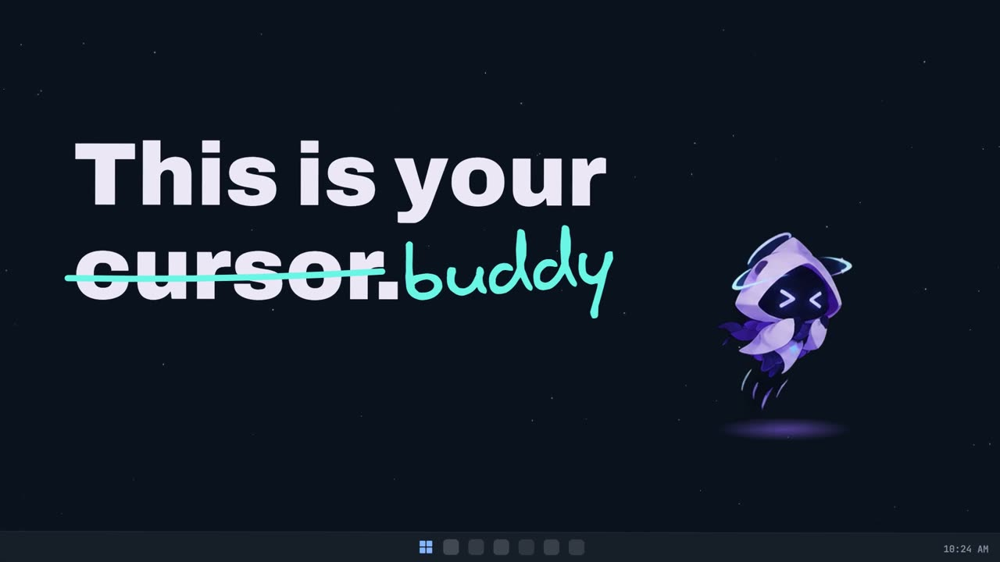

<p align="center">
  
</p>

<h1 align="center">My Buddy</h1>

<p align="center">A glowing AI buddy that lives on your desktop, talks with you, and runs errands in your own Chrome.</p>

<p align="center">
  <a href="https://vjnaveen2005.github.io/my-buddy/"><b>Website</b></a> ·
  <a href="https://github.com/VJNAVEEN2005/my-buddy/releases/latest"><b>Download for Windows</b></a>
</p>

<p align="center">
  <a href="https://vjnaveen2005.github.io/my-buddy/#film"></a><br>
  <sub>▶ Watch the 72-second film (<a href="docs/assets/promo.mp4">MP4</a>)</sub>
</p>

## What it does

- **Talk or type.** Hold Ctrl+Alt and speak, or tap Ctrl+Shift to type. Say **"Hey Buddy"** with the wake word on.
- **Sees your screen.** Ask about anything in front of you; it points at the right button and walks you through steps.
- **Errands in your own Chrome.** With the My Buddy extension on, it works your signed-in Chrome in a background
  tab: cancel a subscription, fill a form, look something up. Risky clicks (cancel, pay, delete, send) always ask you
  first, and it never types passwords or card numbers.
- **Remembers.** Commitments, reminders ("every weekday at 9") and what matters to you.
- **Your model.** Sign in with Claude or ChatGPT, use an API key, or a local model (Ollama, LM Studio).

## Set up the Chrome extension

1. Open `chrome://extensions` and switch on **Developer mode**.
2. Click **Load unpacked** and pick the `showcase/chrome-extension` folder.
3. Keep My Buddy running. The extension connects to it on this computer only (`127.0.0.1:47821`), and only this
   extension's ID is accepted, so web pages can't send it commands.

## Build (Windows)

Needs Node.js 22+, Rust, the MSVC build tools and the Tauri CLI (`cargo install tauri-cli --version "^2" --locked`).
Run these in Git Bash:

```bash
cd showcase/tauri
(cd sidecar && npm ci && npm test)
TAURI_BUNDLES=nsis ./build.sh     # installer in src-tauri/target/release/bundle/nsis/
```

Updates are off: My Buddy has no update feed of its own yet (see `update()` in `src-tauri/src/main.rs`).

## Download

Windows installers are on the [Releases](https://github.com/VJNAVEEN2005/my-buddy/releases) page. To uninstall, use
Windows Settings > Apps > Installed apps > My Buddy > Uninstall.

## Code signing policy

Windows releases are signed so Windows doesn't warn about an unknown app (signing applied for, not active yet).

- Free code signing provided by [SignPath.io](https://signpath.io), certificate by [SignPath Foundation](https://signpath.org).
- Committers and reviewers: [Naveen VJ (@VJNAVEEN2005)](https://github.com/VJNAVEEN2005)
- Approvers: [Naveen VJ (@VJNAVEEN2005)](https://github.com/VJNAVEEN2005)

**Privacy policy:** My Buddy sends what you ask it (and a screenshot, when you ask about your screen) only to the AI
provider you pick in its settings (for example Anthropic, OpenAI, Google, DeepSeek or OpenRouter, or a local model
that never leaves your computer) and to the voice service you turn on (Fish Audio or Gemini). It opens the websites you
ask it to, downloads its speech model from Hugging Face once, and syncs memory only through a folder you choose. It
sends nothing anywhere else, keeps your memory and settings on your computer, and has no analytics or tracking.

## Author

Made by **Naveen VJ**: [GitHub @VJNAVEEN2005](https://github.com/VJNAVEEN2005) ·
[Portfolio](https://vjnaveen.netlify.app/)

## Credits and license

Copyright (C) 2026 Naveen VJ, for My Buddy's own changes and features.
Built on [Roamies](https://github.com/KenKaiii/Roamies), Copyright (C) Ken Kai.

My Buddy keeps Roamies' license, **AGPL-3.0** (see [LICENSE](LICENSE)). If you share My Buddy, or run it as a service for others, you must offer
them its source code. Third-party parts and their licences are in [THIRD_PARTY_NOTICES.md](THIRD_PARTY_NOTICES.md).
